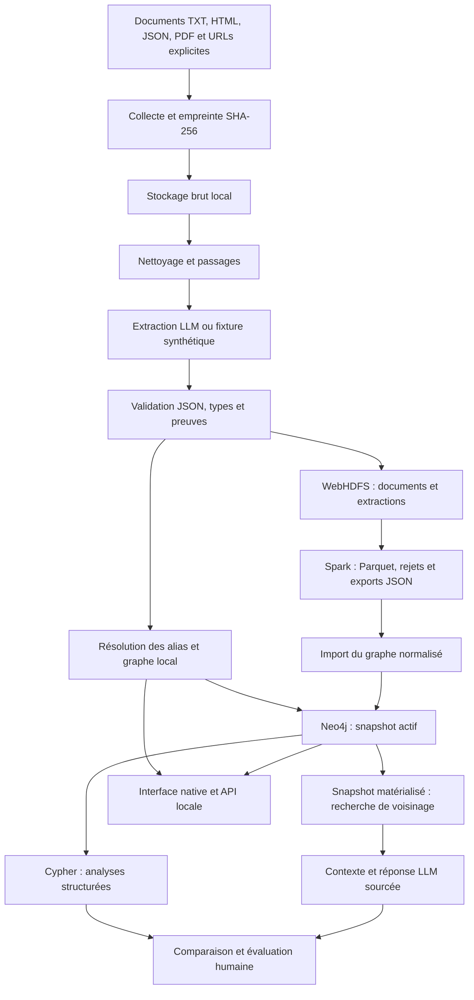

# Architecture de la première version

## Contrats

- `data/raw/` : copies identifiées par empreinte de contenu.
- `data/processed/extractions.jsonl` : un document, un passage, une extraction et
  des métadonnées par ligne ; le texte et les offsets sont conservés.
- `data/graph.json` : listes `nodes`, `facts`, `documents`.
- Chaque fait référence deux identifiants d'entité et une liste de preuves
  `document_id`, `chunk_id`, `evidence`, `confidence`.
- Les identifiants d'entités dépendent du type et du nom normalisé ; les faits
  dépendent des deux extrémités et du type de relation.
- Neo4j conserve un catalogue qui référence le snapshot actif. Les écritures
  s'achèvent avant l'activation ; un échec d'import ne remplace pas ce catalogue.

## Protection des publications et schéma Neo4j v2

Une ingestion comportant une erreur conserve le graphe et les extractions de la
dernière exécution réussie. Chaque document est validé entièrement avant d'ajouter
ses passages au lot. Le rapport de la tentative échouée est séparé du rapport de
la dernière ingestion publiée. La publication locale est prévue pour un seul writer.

Spark réutilise `orgkg.validation.validate_json_line` sur ses workers. Les noms des
extrémités des relations sont joints aux mentions du même document et passage,
puis convertis vers les identifiants canoniques. Les exports sont validés avant
leur import dans le graphe local et avant le premier appel d'écriture Neo4j.

Les labels Neo4j `EntityVersion`, `DocumentVersion`, `FactVersion` utilisent une clé
`snapshot_id:identifiant_logique`. Les relations de preuve sont attachées aux versions,
sans partage entre snapshots. Le hash du snapshot inclut les alias, les propriétés
documentaires et les preuves, avec un ordre canonique ; il exclut les dates de collecte
et les chemins de travail. Les propriétés sont écrites avec `ON CREATE SET`.
Les anciens objets du schéma v1 restent présents, sans modification destructive.
Un nouvel import est nécessaire pour activer une version v2.

L'activation finale verrouille le catalogue et remplace son lien actif en une requête.
La lecture renvoie le snapshot avec ses données ; la comparaison utilise ce même
identifiant, même si un autre import active un nouveau graphe entre-temps.
L'API met en cache le graphe matérialisé et invalide ce cache lors d'un changement
de fichier ou de snapshot actif.

## Limites explicites

La recherche initiale associe les noms et alias présents dans la question puis
explore de un à trois sauts, sans orientation pour le parcours ; le contexte conserve
la direction et le type de chaque fait. La récupération est limitée à 40 faits.
Elle n'analyse pas automatiquement l'intention métier et n'utilise pas d'embeddings.
Une question complexe peut donc nécessiter des faits non récupérés.

Le graphe Neo4j est matérialisé en mémoire pour la recherche GraphRAG et l'interface.
Le cache évite sa relecture complète à chaque question, mais conserve ce coût mémoire.
Pour de grands volumes, remplacer cette lecture complète par une récupération
Cypher ciblée et mesurer ses effets sur la latence et la qualité. Spark utilise
deux threads locaux dans le profil fourni ; déployer de vrais workers avant de
revendiquer un traitement distribué multi-machines.

## Interface web et inférence locale

Le serveur Python sert les ressources HTML/CSS/JavaScript intégrées au paquet, sans CDN ni compilation Node. Le navigateur accède aux routes authentifiées de l'API pour le graphe, les analyses, les documents, les questions et les évaluations. Les téléchargements vérifient le hash de la copie originale et restent confinés au dossier de données. Les imports sont limités en taille et passent par le même contrat de validation que la ligne de commande.

Les opérations POST refusent une origine différente. Une politique CSP interdit les scripts intégrés et les ressources distantes. Le jeton optionnel est conservé en mémoire dans l'onglet. Ces protections conviennent à une utilisation locale mono-utilisateur et ne constituent pas une gestion de rôles pour un déploiement public.

Ollama fournit un endpoint compatible chat completions sur localhost. Les contextes transmis au modèle sont bornés, les citations identifient les faits et une réponse sans identifiants valides est remplacée explicitement par les faits retrouvés. L'extraction vérifie les types, les références et les citations textuelles, avec une tentative de correction. Les échecs de qualité restent visibles dans le rapport d'évaluation.

GDS utilise une projection temporaire des extrémités des faits du snapshot actif, puis la supprime après PageRank et composantes faibles. Les entités isolées sont donc absentes de cette projection GDS, mais présentes dans les analyses locales. Le PageRank GDS brut et le PageRank local normalisé ne doivent pas être comparés sans tenir compte de cette différence.
